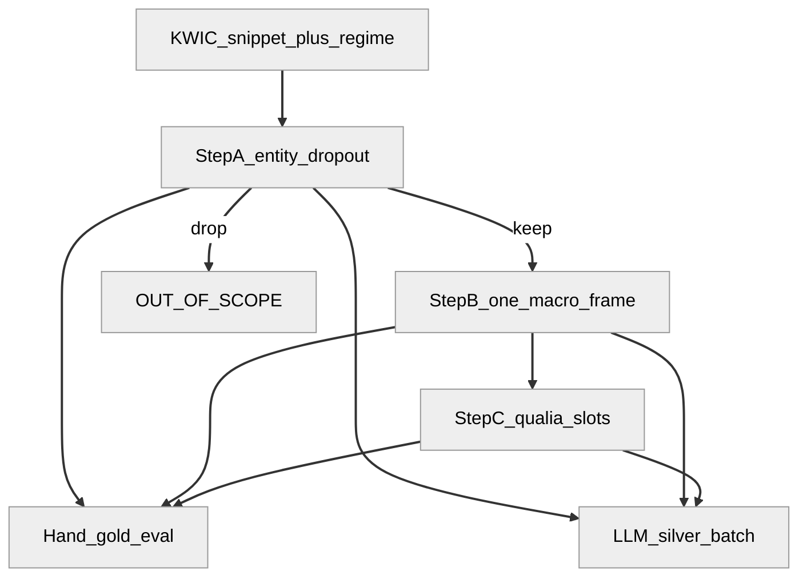
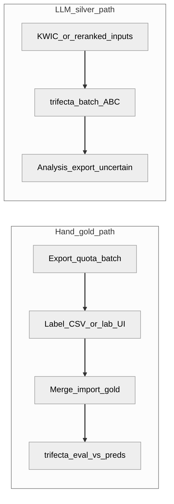
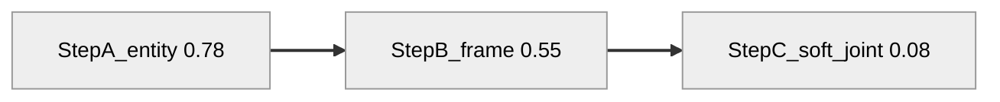

# TRIFECTA Dutch track — paper / methods report

*Living brief for paper Methods and English-track alignment. Prune sections freely.*

**Stats snapshot:** 28 Sep 2026  
**Sources:** `eval/metrics.json`, `eval/report.md`, `eval/frame_disagreements.csv`, `gold_labelling_all.csv` (via `data_io.resolve`)  
**Refresh tables:**

```bash
uv run python scripts/paper_report_stats.py
```

Canonical policy: [ANNOTATION_STRATEGY.md](ANNOTATION_STRATEGY.md). EN coordination: [RESEARCH_STRATEGY_SUMMARY.md](RESEARCH_STRATEGY_SUMMARY.md). Paper fit: [compare_paper_and_NL_approach.md](compare_paper_and_NL_approach.md). Quote hunting: [notebooks/frame_disagreement_review.ipynb](../notebooks/frame_disagreement_review.ipynb).

---

## 1. Purpose

TRIFECTA annotates historic food discourse in layers. The Dutch contribution for the shared paper story is **stage-wise** evaluation (A → B → C) plus **regime-conditioned frame boundaries** — not pooled Step B accuracy alone.

Shared schema with the English track; Dutch adds an explicit **A→B→C cascade** and **INGESTION**. English colleagues moved to **all-at-once** labelling/prediction, **departing from IOB** token schemes. Analytic object: **therapeutic food discourse** in the receipt register ([ANNOTATION_STRATEGY §2.4](ANNOTATION_STRATEGY.md#24-therapeutic-food-discourse-analysis-framing)), not institutional “medicine vs cuisine.”

### Paper claims — keep vs hedge

**Keep (lead with these):**

1. **Stage cascade** — A ≫ B ≫ C: each stage asks a finer question (entity → scenario → roles), so scores fall as the task gets more specific.
2. **Recipe/medical COOKING↔CURE** among Step B misses (prep ↔ remedy in one register).
3. **One frame per window** (+ `notes` for the alternate reading); EN left IOB / all-at-once vs NL staged.
4. **GloBERTise** as best *matched-setup* encoder so far (still under qwen Step B silver baseline) — cite only within a single freeze / export era.
5. **Sparse / hard long-tail frames** — some classes stay thin even after targeted sampling (e.g. **PRESERVING**; **CURE** outside recipe/medical). Further gains may need **corpus extension**, not only more draws from the same KWIC pool. Weak scores also mix **up-front Step B confusion** (e.g. COOKING↔CURE) with true data sparsity — do not attribute everything to “too few training rows.”

**Hedge or drop:**

- Failed / junk LLM compare rows (e.g. Apertus 0.000) — omit.
- Literary/travel **CURE↔INGESTION** as a finding — **not** supported; that bucket is **INGESTION↔NONE**.
- One ranking across **n=123 / 157 / 308 / 432** — different freezes; use matched panel or label eras.
- **Soft micro** as if it were role-level F1 — use as upper-bound field overlap; lead with **soft joint** (full row) for “usable Step C.”

---

## 2. Procedure

### 2.1 Layers

| Layer | Question | Output |
|-------|----------|--------|
| **0 — `text_regime`** | What kind of text? | `RECIPE_PRACTICE`, `MEDICAL`, `LITERARY`, `TRAVEL`, … |
| **A** | Food entity in context? | Keep / drop (metaphor, out of scope) |
| **B** | Which **one** macro-frame? | `COOKING_CREATION` \| `CURE` \| `INGESTION` \| `PRESERVING` \| `NONE` + `lexical_unit` |
| **C** | Which qualia for that frame? | Frame-specific slots only |

**Regime ≠ frame.** Genre is a prior for interpreting errors; it does not decide the label. Step B = snippet-level **mode of expression** (prep / remedy / consume / …).

**One frame per window.** Alternate reading → `notes` (and optionally Step C under the chosen frame). Do not stack frames for the tagger.

### 2.2 Flowchart



### 2.3 Swimlane — hand gold vs LLM silver



Hand path is the eval reference. Silver is hypothesis unless the row is hand gold.

---

## 3. Statistics (frozen snapshot)

### 3.1 Gold inventory

| | n |
|--|--:|
| Labelled rows (`labelled=true`) | **432** |
| Eval records (`metrics.total`) | **432** |
| Step C scored rows (`step_c_gold_rows`) | **186** |
| Rows with any Step C field filled (CSV scan) | **192** |

**Selected frame (labelled):**

| Frame | n |
|-------|--:|
| INGESTION | 116 |
| *(empty frame)* | 83 |
| CURE | 68 |
| NONE | 66 |
| COOKING_CREATION | 65 |
| PRESERVING | 34 |

**Text regime (labelled):**

| Regime | n |
|--------|--:|
| LITERARY | 129 |
| RECIPE_PRACTICE | 126 |
| UNKNOWN | 65 |
| MEDICAL | 64 |
| TRAVEL | 38 |
| ADMIN_TRADE | 8 |
| SCIENTIFIC | 2 |

### 3.2 Stage cascade (Graph 1)

| Stage | Metric | Value |
|-------|--------|------:|
| A | Entity accuracy | **0.775** |
| A | Metaphor accuracy | 0.806 |
| A/B | Dropout agreement | 0.778 |
| B | Frame accuracy (pooled) | **0.552** |
| C | Soft **joint** (all fields / row) | **0.081** |
| C | Soft micro (field-pooled; diagnostic) | 0.255 |
| C | Exact micro / joint | 0.229 / 0.065 |



**Claim:** each stage asks a finer question (entity → scenario → roles), so scores fall as specificity rises. Soft micro (~0.25) only means partial field overlap; **soft joint (~0.08)** is the right headline for “almost no complete qualia rows match gold.”

### 3.3 Step B per-frame (precision first)

| Frame | P | R | F1 |
|-------|--:|--:|--:|
| PRESERVING | **0.895** | 0.515 | 0.654 |
| INGESTION | **0.782** | 0.473 | 0.589 |
| CURE | **0.707** | 0.537 | 0.611 |
| COOKING_CREATION | 0.494 | **0.689** | 0.575 |
| NONE | 0.286 | 0.579 | 0.383 |

### 3.4 Step B by `text_regime` (primary eval cut)

| Regime | n (eval) | Step B accuracy |
|--------|--------:|----------------:|
| LITERARY | 64 | **0.656** |
| MEDICAL | 41 | 0.561 |
| TRAVEL | 22 | 0.545 |
| RECIPE_PRACTICE | 105 | 0.524 |
| ADMIN_TRADE | 2 | 0.500 |
| UNKNOWN | 42 | 0.476 |
| SCIENTIFIC | 1 | 0.000 |

### 3.5 Step C by frame (soft micro)

| Frame | n | Soft micro | Soft joint |
|-------|--:|----------:|-----------:|
| PRESERVING | 27 | 0.296 | 0.148 |
| INGESTION | 65 | 0.286 | 0.077 |
| COOKING_CREATION | 38 | 0.237 | 0.026 |
| CURE | 56 | 0.152 | 0.089 |

### 3.6 Model comparisons

Two tracks: **LLM silver** (A→B→C on gold) vs **encoder fine-tunes** (Step B only). Hybrid classifier-in-batch remains deferred while encoders stay under the qwen Step B baseline (~0.75 on the frozen Jul eval).

**Sources:** `eval/model_comparison*.md`, `gijsbert/models/<run>/report.md`. Refresh classifiers:

```bash
uv run python scripts/compare_gijsbert_runs.py
# LLM (expensive): ./scripts/run_model_compare.sh
```

#### 3.6.1 LLM silver (gold eval slice)

Historic July 2026 sweep on the **123-row** frozen gold ([ANNOTATION_STRATEGY §6](ANNOTATION_STRATEGY.md#6-llm-and-models)):

| Model | Step B | Step A entity | Notes |
|-------|-------:|--------------:|-------|
| qwen2.5:14b-instruct | **0.763** | — | 100-row slice |
| qwen2.5-coder:latest | **0.736** | 0.764 | Default batch model; 123 rows |
| mistral 7B | 0.609 | — | July table |

**Current** gold eval in this report (432 rows, same default LLM family) has Step B **0.552** — larger / harder gold, not a drop from 0.736 on the same set. Prefer stage metrics in §3.2 over mixing these tables. Matched freeze panel: `uv run python scripts/matched_step_b_panel.py`.

#### 3.6.2 Step B encoders (fine-tune vs qwen baseline 0.75)

Sorted by **dev accuracy (all labels)**. Dev size differs by export era — do not over-interpret cross-block deltas.

**Early exports (dev n≈157):**

| Run | Base model | Dev all | Dev frames-only | NONE F1 | Notes |
|-----|------------|--------:|----------------:|--------:|-------|
| gysbert-v2-balanced-none | `emanjavacas/GysBERT-v2` | **0.624** | 0.348 | 0.82 | m9 reference |
| gysbert-v2-reizen-light | `emanjavacas/gysbert` | 0.643 | 0.382 | 0.81 | light NONE |
| gysbert-v2-reizen-none | `emanjavacas/gysbert` | 0.618 | 0.353 | 0.83 | |
| historic-dbmdz-balanced-none | `dbmdz/bert-base-historic-dutch-cased` | 0.618 | 0.382 | 0.82 | |
| gysbert-v2-none-oversample-10 | `emanjavacas/gysbert` | 0.484 | 0.397 | 0.69 | 10× NONE oversample |
| gysbert-v2-frames-only | GysBERT-v2 | 0.377* | 0.377 | n/a | 4-class, no NONE |
| gysbert-v2-llm-silver | GysBERT-v2 | 0.223 | 0.449 | 0.09 | train lacked NONE |
| gysbert-v2 (raw) | GysBERT-v2 | 0.217 | 0.493 | 0.00 | pre-balance |
| historic-dbmdz (raw) | historic Dutch BERT | 0.166 | 0.377 | 0.00 | pre-balance |

\*frames-only head on framed subset.

**Larger silver train / larger gold dev (dev n=308 or 432; balanced NONE):**

| Run | Base model | Dev n | Dev all | Dev frames-only | NONE F1 |
|-----|------------|------:|--------:|----------------:|--------:|
| **globertise-balanced-none** | `globalise/GloBERTise` | 308 | **0.724** | **0.574** | 0.83 |
| gysbert-v2-balanced-none-weekend | `emanjavacas/gysbert` | 432 | 0.704 | 0.564 | 0.80 |
| bertje-balanced-none | `GroNLP/bert-base-dutch-cased` | 308 | 0.692 | 0.521 | 0.80 |
| mbert-balanced-none | `bert-base-multilingual-cased` | 308 | 0.672 | 0.479 | 0.80 |

**Read-out:** On the expanded setup, **GloBERTise** leads pooled Step B (0.724) and frames-only (0.574), still shy of qwen’s ~0.75 silver baseline. GysBERT weekend run is close (0.704 / 0.564). NONE F1 is strong across balanced runs; long-tail **CURE / INGESTION / PRESERVING** remain the gap — aligns with regime × boundary analysis (§4), not a reason to drop staging.

#### 3.6.3 Implication for the paper

- Compare **stages** (A ≫ B ≫ C) and **encoder vs LLM for Step B on one freeze**, not LLM brand tables from mixed n.
- GloBERTise is the best encoder *in the large balanced-none block*; do not merge that rank with July n=123 LLM scores.
- Classifier = scale / pre-filter candidate; Step C stays LLM + hand gold.

### 3.7 Gold prior (Graph 4)

Approximate bar lengths (labelled frame counts; empty frame omitted from bars):

```text
INGESTION          116  ##############################
CURE                68  #################
NONE                66  ################
COOKING_CREATION    65  ################
PRESERVING          34  ########
```

CURE is common in recipe/medical gold; scarce in literary/travel (see contradictions).

---

## 4. Frame contradictions

### 4.1 Labelling vs interpretation

| Role | Genre / `text_regime` | Step B frame |
|------|------------------------|--------------|
| When labelling | Do not decide the frame | Local scenario only |
| When reading results | Stratify; expect different blends | What annotator/model chose |

### 4.2 Confusion among frame disagreements (Graph 2)

**n = 124** Step B mismatches (`frame_disagreements.csv`).

| gold \ pred | COOKING | CURE | INGESTION | NONE | PRESERVING |
|-------------|--------:|-----:|----------:|-----:|-----------:|
| COOKING_CREATION | 0 | 4 | 3 | 11 | 1 |
| CURE | **12** | 0 | 4 | 9 | 0 |
| INGESTION | 11 | 3 | 0 | **34** | 0 |
| NONE | 6 | 4 | 5 | 0 | 1 |
| PRESERVING | **14** | 1 | 0 | 1 | 0 |

Largest cells: **INGESTION→NONE**, **PRESERVING→COOKING**, **CURE→COOKING**.

### 4.3 Regime × boundary rates (Graph 3)

Among frame disagreements:

| Bucket | n | COOKING↔CURE | CURE↔INGESTION | INGESTION↔NONE | COOKING↔INGESTION |
|--------|--:|-------------:|---------------:|---------------:|------------------:|
| recipe_medical (`RECIPE_PRACTICE`+`MEDICAL`) | 68 | **14 (20.6%)** | 1 (1.5%) | 7 (10.3%) | 5 (7.4%) |
| literary_travel (`LITERARY`+`TRAVEL`) | 32 | 1 (3.1%) | 1 (3.1%) | **19 (59.4%)** | 6 (18.8%) |

**COOKING↔CURE directionality (recipe_medical):** gold CURE → pred COOKING **11**; gold COOKING → pred CURE **3**.

**Evidence-backed:** recipe/medical errors concentrate on **prep ↔ remedy** (prepare-for-cure register).

**Honest on literary/travel:** dominant problem is **INGESTION ↔ NONE** (and COOKING↔INGESTION), **not** CURE↔INGESTION. CURE gold in that bucket is thin — the “cure entangled with eating” hunch is **underpowered**, not confirmed by this slice.

### 4.4 Mode-blend conceptual (Graph 6)

```mermaid
%%{init: {"theme": "neutral", "themeVariables": {"lineColor": "#333333"}}}%%
flowchart TB
  subgraph recipeMedical [Recipe_and_medical_inclined]
    prep[COOKING_prep_mode]
    cure1[CURE_remedy_mode]
    prep <-.->|often_cooccur| cure1
  end
  subgraph litTravel [Literary_and_travel]
    cure2[CURE_thin]
    ingest[INGESTION_consume_mode]
    noneMode[NONE_non_practice]
    ingest <-.->|model_errors| noneMode
    cure2 -.->|underpowered_in_gold| ingest
  end
  linkStyle 0,1,2,3,4 stroke:#333333,stroke-width:2px
```

**Modes of expression** = Step B scenarios. **Genre** = setting that biases which modes blur.

### 4.5 Service / use verbs

`serveren` / `aanbieden` / `gebruiken` are **not** frames. Resolve to INGESTION / COOKING / CURE / NONE from local scenario ([ANNOTATION_STRATEGY §2.1](ANNOTATION_STRATEGY.md#21-cooking_creation-vs-cure-recipe--cure-frame)).

---

## 5. EN vs NL box (extra 7)

| | English track | Dutch track |
|---|---------------|-------------|
| Protocol | **All-at-once** (entity / frame / roles in one pass) | **Staged** A → B → C with early dropout |
| Legacy | **Departed from IOB** token schemes (stacking / multi-frame BIO was a motive to leave) | Never primary; structured JSON + one macro-frame per KWIC window |
| Unit | Full-doc / span tools (INCEpTION etc.) | KWIC + `record_id` |
| Frames | Same macro-frames (+ paper DESCR) | Same + **INGESTION** |
| Hard lesson | Joint prediction blurs where error sits | Stage-wise metrics: A ≫ B ≫ C; alternate reading → `notes` |
| Eval story | Harmonization / correction rates on joint output | Per-stage + per-regime (+ boundary slices) |
| IDs | No shared `record_id` with NL | — |

**Paper contrast:** not “BIO vs JSON,” but **joint all-at-once (post-IOB) vs staged cascade** — same guideline family, different protocol cost and error locality.

---

## 6. Worked trio — same cure-recipe book (extra 8)

| Snippet (gloss) | Frame | Why |
|-----------------|-------|-----|
| “Neem viooltjes en honing, kook alles tot een dikke siroop.” | **COOKING_CREATION** | Preparation (`kook`), even if the book is “against cough” |
| “Deze siroop verzacht de droge hoest.” | **CURE** | Affliction + food-as-treatment |
| “Geef des morgens een lepel van de siroop.” | **CURE** or **INGESTION** | Prefer **CURE** when dosing-for-treatment is explicit |

---

## 7. Quote slots (extra 10)

Fill from `notebooks/frame_disagreement_review.ipynb` (`FOCUS=COOKING_CURE` or notes-first walk). Prefer rows with non-empty gold `notes`.

| # | record_id | gold | pred | regime | note / snippet |
|---|-----------|------|------|--------|----------------|
| Q1 | *(todo)* | | | | |
| Q2 | *(todo)* | | | | |
| Q3 | *(todo)* | | | | |

---

## 8. What this report is not

- Disagreement-driven automatic gold growth (adjudicate selectively via `gold_fixes.csv`)
- Swapping the Dutch story to “GloBERTise replaces staging”
- Wiring collocation skeleton hints into GijsBERT export ([COLLOCATION.md §6](COLLOCATION.md#6-gijsbert-export-audit-9-jul-2026) — blocked)
- Paper claims listed under **Hedge or drop** in §1

---

## 9. Conclusion

**Qualia are hard.** Soft joint ~0.08 on hand gold — almost no full role bundles match even under containment. Staging still matters: entity/frame can improve while use/role extraction stays the bottleneck (same family of finding as the English all-at-once track’s long-tail frames).

**Literal qualia matching may be too much to ask.** Historic Dutch is orthographically and rhetorically messy; gold and silver often paraphrase the same affliction or method. Exact (and even soft-containment) string match is a **diagnostic ceiling**, not the right success criterion for analysis. Prefer: per-field usefulness with human spot-check, soft scores as upper bounds, and claims grounded in fields that clear a reliability bar — not joint row identity.

**The corpus is very varied.** Regimes span recipe, medical, literary, travel, …; Step B confusions shift with genre (recipe/medical → COOKING↔CURE among misses; literary/travel → INGESTION↔NONE). Pooled Step B or a single soft-micro number understates that mix. Report **by stage and by regime**; therapeutic food discourse is cross-register, not one “medical” shelf.

**Some frames stay rare even after better sampling.** Targeted quotas and clear-frame exports already chase PRESERVING / CURE / overlap phenomena; remaining thin cells may need **corpus extension** (new sources/registers), not only re-mining the same pool. Separately, **Step B confusion** (prep vs remedy, dose vs eat) inflates “hard frame” error before Step C or classifier training ever sees a clean label — sparsity and **up-front frame mix-up** should be reported as distinct factors.

---

*Draft aligned with agreed keep/hedge list. Numbers: `scripts/paper_report_stats.py`; matched Step B: `scripts/matched_step_b_panel.py`.*
